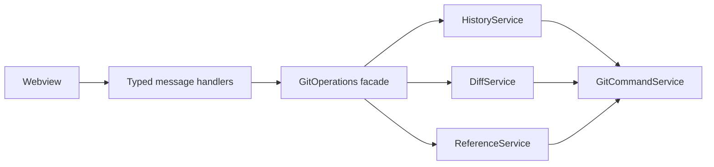

# Dashboard backend architecture

The redesigned dashboard uses a read-oriented backend instead of expanding the existing write-operation handlers. The UI requests only the data needed by the active view, commit, or file.

## Boundaries

- `GitCommandService` is the process and trust boundary. It executes Git without a shell, validates repository paths, validates file paths, and resolves revisions to commit hashes.
- `HistoryService` owns paginated commit history and history search. It returns commit parents so the webview can render a commit graph without parsing Git text.
- `DiffService` owns commit metadata, changed-file lists, and on-demand file patches. Patch output is capped at 1 MiB before it crosses the webview boundary.
- `ReferenceService` aggregates branches, tags, remotes, and stashes for the selected repository.
- `stashTarget` reads a stash as one change. Only commits in the stash reflog count as stashes. For a stash made with untracked files (`git stash -u`, kept in a third parent), the file list and patches (`DiffService`), summaries (`ChangeContextService`) and reviews (`ReviewSnapshotService`) read a commit that adds those files to the stash's tree, on its first parent; it is built in a temporary index with the stash's own identity and dates, so the same stash always gives the same commit (its message names no `stash@{n}`, which moves when another stash is pushed), and the working tree, index and stash are untouched. A saved review that read one keeps it under `refs/repository-manager/snapshots/`, like a review of local changes. The webview keeps the stash's own hash. `HistoryService` and summaries leave out the index and untracked-files commits inside every stash (unless one carries a ref or is the revision the history was asked from), the history draws a stash on its first parent, and a stash's commit detail carries `stash` (its `stash@{n}`, branch and message) for the header.
- `DiscardService` discards uncommitted changes: one file, several (a selection) or all, from the context menus of the changed files and the Uncommitted changes row, the Side Bar's Changes and the files list's Discard button (`handleDiscardChanges` asks first, from the host). Tracked files go back to HEAD with `git restore --source=HEAD --staged --worktree` (a rename on both sides); new files that are not ignored are deleted directly (a file at a time, inside the repository only, a symbolic link itself and never its target), and folders left empty go too. Before anything changes, the files about to change are copied into a commit (`snapshotLocalChanges` with those paths, on top of the index) kept by a ref under `refs/repository-manager/discarded/` (the newest 20; the history excludes them). The ref is written, and older copies dropped, while the files are put back: the copy is a commit already, and the ref only protects it from a later garbage collection. The message after offers **Undo** (`restore`): the files come back from the copy as unstaged changes and new files, except any changed again since the discard, which are left as they are. Linked repositories (gitlinks) and new nested repositories are left alone, and nothing runs without a first commit or while a merge, rebase, cherry-pick or revert is paused. The checks (HEAD, paused operation, the plan's `git status`) run in parallel, and the plan's status serves the restore too, so a discard waits on about ten Git processes in a row instead of about thirty.
  - The webview hears `discardStarted` as soon as the question is answered and leaves those files out of every list at once; the host then posts the new status (`workingTreeChangesLoaded`) and `discardFinished`, which puts back any file Git did not discard. The history does not change, so it is not reloaded.
- `StashActionService` runs Apply, Pop and Drop from the header of a stash shown on its own (not in a comparison). The webview sends the stash's hash. Apply passes the hash to Git; Pop and Drop only take a `stash@{n}`, so the service looks it up in the reflog just before running them, and runs the actions in a repository one at a time, so a second click cannot act on the stash that moved into the first one's position. A stash that is gone is reported. Apply and Pop work on a dirty tree as Git does (Git refuses, changing nothing, when a local edit or an untracked file is in the way); they refuse while the tree already has conflicts, so conflicts afterwards are the stash's. A conflicting Pop keeps the stash. Git can also stop partway without a conflict (a `-u` stash whose untracked file is already in the way, after its tracked changes are restored): the status before and after tells, and that is reported as partway, with the changes shown. Only Drop asks first, from the host (`handleStashAction`), and its message names the hash `git stash store` takes to bring the stash back. When the working tree changed or the stash was removed the host posts `stashActionCompleted` before reloading: the webview opens the uncommitted changes with the next status if the tree changed, and drops a history filter naming a `stash@{n}` (set from the Stashes list) if a stash was removed, since that position is now gone or another stash.
- `GitOperations` remains a thin facade. It exposes services to VS Code handlers but contains no parsing or view-specific state.
- `webviewMessageHandler` validates untrusted webview payloads and converts service results into typed events.

Existing write services remain separate:

- `BranchService`: create, checkout, pull, push, fetch, and delete branches. Push uses the branch's own remote (`branch.<name>.remote`, else `origin`) and refuses a detached HEAD with a message instead of a Git error. Push after creating a branch (Confirm & Push) pushes that branch by name, says for each repository that failed why, and reloads the history of those pushed so their new remote branch shows.
- `SubmoduleService`: discover linked repositories and perform submodule-specific synchronization. Each repository's status carries `changeCounts` (staged, modified, untracked, conflicted) from the same `status --porcelain=v2` call.
- `CommitService`: the commit dialog's working-tree changes, previews and commits, plus legacy recent-commit operations and remotes.

### Uncommitted changes

The dashboard asks for the active repository's working tree (`getWorkingTreeChanges` with `purpose: "dashboard"`; the commit dialog asks without it) after each history load and each repository list update. With changes, an **Uncommitted changes** row is shown above the history; it is not a commit row, so the graph and commit selection are unchanged. Selecting it lists the changed files and loads each one's staged or unstaged diff (`getWorkingTreePreview`, the commit dialog's preview, with its own request ids). With changes and no commit picked by the user in that repository, the dashboard selects the row; once the tree is clean it falls back to the newest commit. The detail pane is laid out like a commit's (title, counts, branch and `HEAD <sha> → working tree`, `*` for the hash), and the header's actions, top-right after the hash, are **Review changes** and **Summarize changes** (committing is the toolbar's **Commit**, so there is one Commit button). For a commit or comparison the header holds **Summarize changes** alone (and **Cancel** while it runs). The actions sit in `#commitHeaderActions`, beside the header content in one grid (`.commit-header`; the content element is `display: contents`), so redrawing the content for a new selection never redraws them. The bar below (`#changeSummary`) holds only the summary's status and result, and shows only while one of them has content. Summarize sends `summarizeChanges` with `local: true`; the panel takes the same snapshot Review changes takes (`snapshotLocalChanges`) and summarizes HEAD → snapshot, so nothing is committed or staged. **Review commit** is disabled there: it reviews commits.

The Side Bar shows the same files as **Changes**, right under Branches. Clicking one opens it in VS Code's diff editor, in a tab (`openChangeInEditor`, `src/changeDocuments.ts`): HEAD ↔ the file on disk, which stays editable; a new or conflicted file opens as it is. The committed side is a read-only document of the `repository-manager-git` scheme whose URI names the repository, the full commit hash and the path, so a tab VS Code restores after a reload still shows it; only repositories inside a workspace folder and full hashes are read. The dashboard's files list opens the same way (double-click, **Open ↗** above the diff, or **Open Changes** in the menu), for a commit's or comparison's files as base ↔ target too. Files are picked for Discard with checkboxes or Ctrl/Cmd- and Shift-click in either list (the Side Bar passes the keys with its clicks); both lists show one selection. Branches and Changes fold to their titles, and any branch folder folds, the one holding HEAD included (it then shows HEAD).

`LiveChanges` (`src/liveChanges.ts`) keeps this current: a workspace file watcher (VS Code's, which honours `files.watcherExclude`) reports events, and once they have been quiet for 800 ms one repository list refresh runs. Inside `.git`, only the index, HEAD, refs, packed-refs and info/exclude count; objects, logs, hooks and lock files are ignored, and so is an index rewrite in the 1.5 s after a refresh (`git status` writes it). A batch of only working-tree files is first checked with `git check-ignore --stdin` in the repository that holds each file (`src/services/ignoredPaths.ts`); when Git ignores all of them (build output, dependency folders), no refresh runs. A tracked file is never reported as ignored. A batch over 2000 files, or a check that fails, refreshes without checking. While neither the dashboard nor the Side Bar is visible, or a Git action runs, the refresh waits and runs once afterwards. `repositoryManager.liveChanges` turns it off.

### Committing selected files

`commitFiles` builds the commit in a temporary index (`GIT_INDEX_FILE`) that starts from HEAD and receives only the selected files, then commits it. The real index is not touched until the commit exists, so a commit that fails (a rejecting hook, for example) leaves your staging exactly as it was, and staged files you did not select stay staged and uncommitted. A selected file that was staged and then changed again needs a choice (`partial`): `staged` commits the staged version and leaves the later changes unstaged; `whole` commits the file as it is in the working tree. Afterwards the selected paths' index entries are reset to the new commit. The dialog's filter (All, Tracked, Untracked) only hides rows: a commit, and Write with Copilot, take the ticked files it shows, and the count says how many ticked files it hides. With `push`, the dialog pushes the current branch once the commit exists; a failed push keeps the commit and says so. The Push after commit choice is remembered per repository root in workspace state.

### Commit messages written by Copilot

**Write with Copilot** sends `generateCommitMessage` with the selected files and the partly staged choice. `CommitMessageController` (`src/commitMessageController.ts`, no VS Code dependency) collects the diff the commit would record (`collectCommitDiff` in `services/commitMessage.ts`: HEAD → working tree, or the staged part; at most 60 KB, larger files are named instead) and the repository's commit convention (`findCommitConvention`): the sections about commits in AGENTS.md, CLAUDE.md and CONTRIBUTING.md (also under `.github/` and `docs/`), plus a commitlint config. A repository with none of these gets Conventional Commits 1.0.0. Before sending code it asks only when `repositoryManager.copilot.askBeforeSending` says so, as a review does, and shares the review's per-repository "Always allow". The reply is cleaned (code fences, quotes and attribution trailers removed) and posted as `commitMessageGenerated`; the dialog puts it in the message box, keeps the previous draft for Undo, and says which convention was followed. Nothing is committed until the user commits.

## Dashboard protocol

| Request | Response | Loading strategy |
|---|---|---|
| `getHistory` | `historyLoaded` | Page commits, default 100 and maximum 200 |
| `getCommitDetail` | `commitDetailLoaded` | Load after the user selects a commit |
| `getFileDiff` | `fileDiffLoaded` | Load after the user selects a changed file |
| `getRepositoryRefs` | `repositoryRefsLoaded` | Load after selecting a repository |
| Any failed read | `dashboardError` | Show an error in the affected view |

History supports repository path, page limit, offset, text search, branch selection, and optional remote refs. Search covers commit hash, author, email, subject, and decorated refs.

### Opening the dashboard

The graph is the first thing the dashboard has to show, so opening it waits on as few Git processes as possible. Each process costs its start-up time, which on Windows with a virus scanner can be a large part of a second.

- The page is shown before the repositories are listed. `RepositoryManagerPanel` keeps the last list in workspace state (`repositoryManager.repositoryList`, with the folder it belongs to) and shows it at once; with nothing saved it shows the folder's own repository alone, status unknown, when the folder has a `.git`. Listing the linked repositories and reading their status follows, and arrives as `updateSubmodules`. A folder that is not a repository waits for the list, so no repository appears that is not there.
- The first background fetch waits until the first history page has been sent, or `FIRST_FETCH_DELAY_MS` (3 s) after opening, whichever is first, and then until no request is being answered: the request that ends last starts it. Before, it ran at once and listed every repository a second time and fetched each one while the history was being read.
- `HistoryService` reads the upstream and the stashes while the log runs, not after it, so a history page waits on one Git process: the log. A search reads them after its scan, so a search replaced by the next keystroke starts neither.

`repositoryManager.debug.timings` (off by default) writes the steps of opening (page shown, history asked and sent, repositories listed, history drawn) and every Git command with its duration and folder (searches, file contents and ignore checks included), for its first 30 seconds, to the **Repository Manager Timings** output. `npm run bench:load` opens the real panel on a generated repository (5000 commits, three linked repositories) with its page in Chromium, and can add a delay to every Git process (`BENCH_SPAWN_MS`) to stand in for a slow machine. It replaces a `BENCH_FIXTURE` folder only if it made it, and refuses any other non-empty folder.

## Data flow

1. The panel loads the lightweight repository overview already used by Repository Manager.
2. Selecting a repository requests refs and the first history page in parallel.
3. Selecting a commit requests metadata and its changed-file list.
4. Selecting a file requests only that file's patch.
5. Write operations refresh the lightweight overview; the frontend invalidates history/detail data for the affected repository.

This avoids loading every commit and patch when the panel opens, keeps the extension responsive on large repositories, and allows each lower panel to display an independent loading or error state.

## Safety and limits

- Git arguments are passed through `execFile`; they are never concatenated into a shell command.
- Repository paths must stay inside the active workspace.
- File paths must be repository-relative.
- Revisions are resolved with `git rev-parse --verify <revision>^{commit}` before use.
- History commands use a 15-second timeout and bounded result counts.
- File patches are truncated at 1 MiB and marked with `truncated: true`.

## Follow-up adapters

The architecture leaves separate slots for `WorkingTreeService`, `ReflogService`, `WorktreeService`, and a GitHub pull-request adapter. These should be added as independent read services when their dashboard views are implemented; they should not be folded into `HistoryService` or `GitOperations`.
